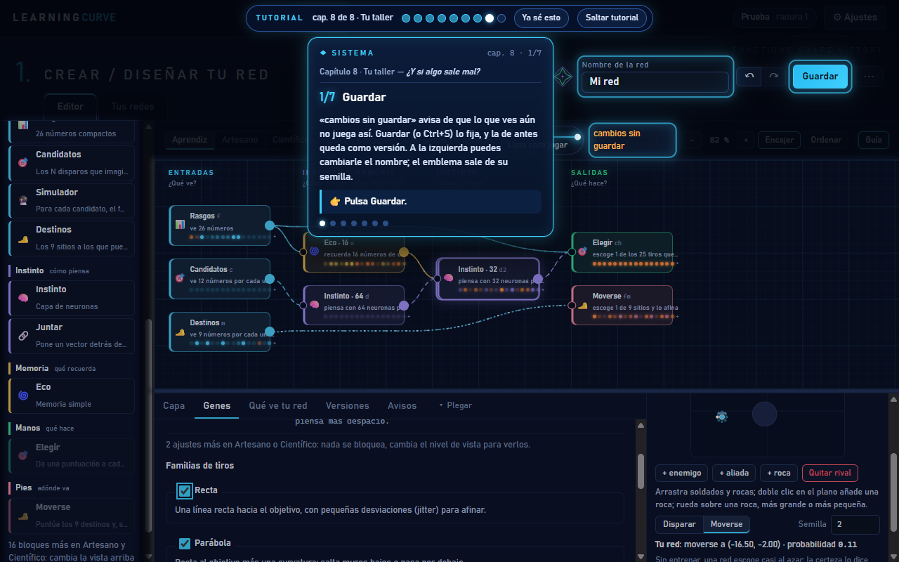
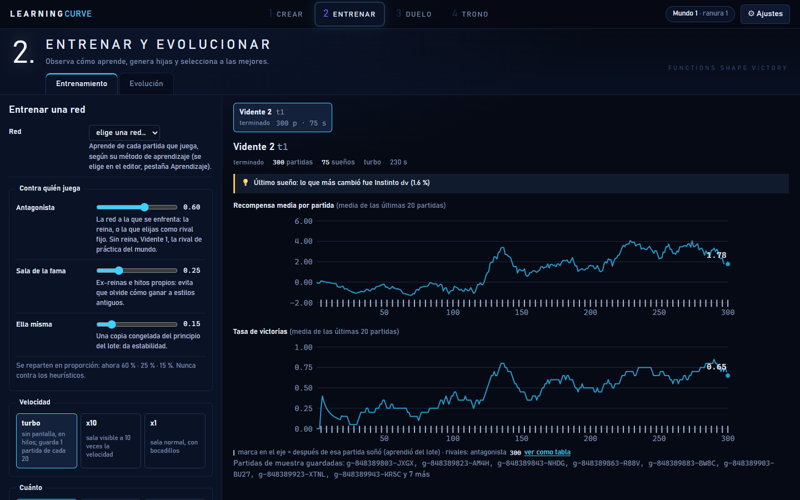
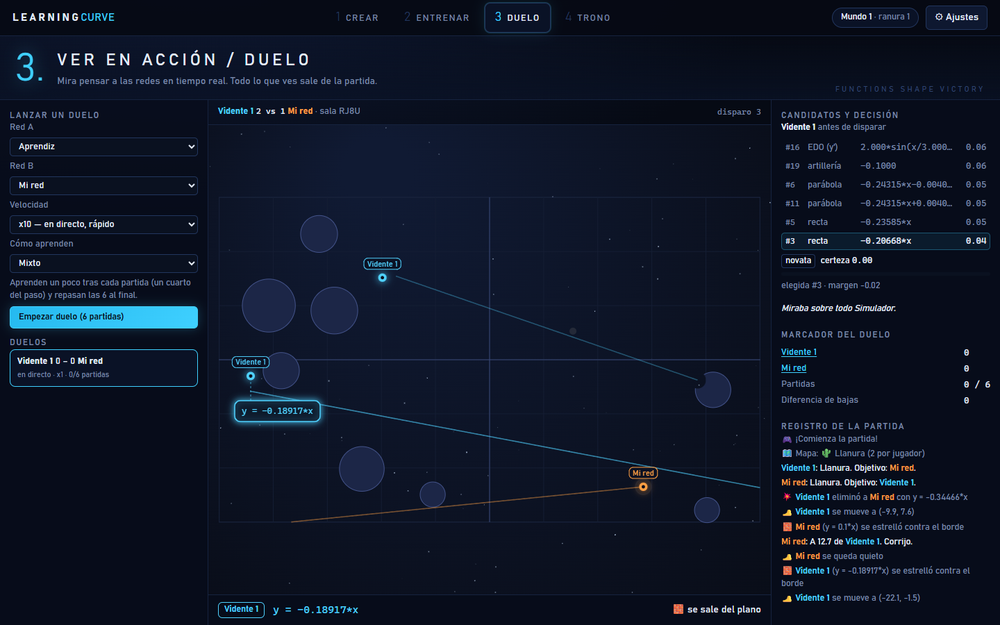
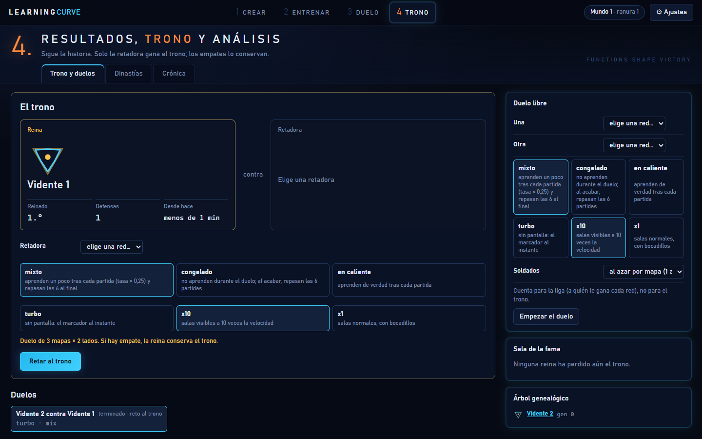
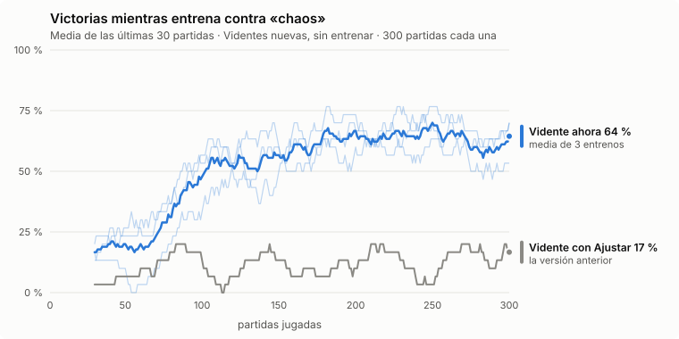
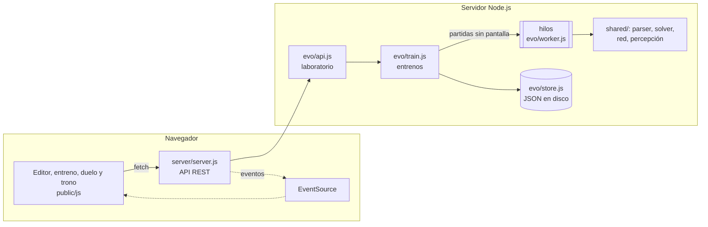

<div align="center">
  <h1>Learning Curve</h1>
  <p>Diseñas una red neuronal pieza a pieza, la entrenas con aprendizaje por refuerzo y la miras aprender a disparar funciones matemáticas.</p>

  <p>
    
    
    
    
    
  </p>
  <p>
    <a href="__DEMO_URL__"></a>
    
    
  </p>
</div>

En [Graphwar](https://www.graphwar.com/), el juego de Lucas Catabriga, cada jugador dispara escribiendo una función: `y = 0.5*x` es una recta, `y'' = -0.05` una parábola. Learning Curve usa esa mecánica, pero aquí tú no disparas. Montas el cerebro de un soldado con bloques (qué ve, qué recuerda, cómo decide), lo entrenas jugando cientos de partidas y ves cómo cambia su forma de apuntar. Luego le crías hijas con mutaciones, las enfrentas en duelos y la mejor se queda con el trono.

Todo el aprendizaje está escrito a mano en JavaScript, sin librerías de machine learning: la red, la retropropagación, el optimizador Adam y las estrategias evolutivas.

**Pruébalo:** [__DEMO_URL__](__DEMO_URL__)

<sub>La demo está en el plan gratuito de Render: si nadie la ha usado en un rato, tarda alrededor de un minuto en despertar. Es compartida, se vacía en cada reinicio y tiene límites para no saturarse (entrenos de 300 partidas como mucho y dos a la vez).</sub>

<!-- VIDEO_TUTORIAL: enlace de user-attachments de _work/video-lc/tutorial.mp4 y debajo:
<sub>El tutorial «Tu primera red», acelerado: el editor empieza a oscuras y se va encendiendo a medida que montas la red.</sub>
-->

## Qué hace

Cada partida guardada es un mundo con sus redes, su trono y su historia, y empieza con una copia de Vidente 1 como rival de práctica. El juego tiene cuatro etapas:

| 1. Crear | 2. Entrenar |
| :---: | :---: |
|  |  |
| El editor de redes: bloques a la izquierda, el grafo en el centro y un banco de pruebas que enseña qué tiro escoge la red y por qué. | Una Vidente nueva entrenando 300 partidas contra `chaos`: sus victorias pasan de casi ninguna a un 65 %. Después de cada lote la red "sueña" y aprende, y la interfaz dice qué bloque cambió más. |

| 3. Duelo | 4. Trono |
| :---: | :---: |
|  |  |
| Dos redes juegan en directo. A la derecha, los candidatos que barajó la red, la probabilidad de cada uno y el registro de la partida. | Esa Vidente, ya entrenada, le quita el trono a Vidente 1, que pasa a la sala de la fama. También están los duelos mapa a mapa, las dinastías y el árbol genealógico. |

<!-- VIDEO_DUELO: enlace de user-attachments de _work/video-lc/duelo.mp4 y debajo:
<sub>Un duelo en directo entre Vidente 1 y una red recién creada.</sub>
-->

Al crear una partida eliges desde dónde empiezas, y eso decide cuánto enseña el editor:

| Camino | Vista del editor | Para quién |
| :--- | :--- | :--- |
| Desde cero | Aprendiz | No sabes nada de redes. Ves lo justo y todo se explica con ejemplos. |
| Ya sé algo | Artesano | Sabes qué es una red neuronal. Ves más ajustes desde el principio. |
| Sé de RL | Científico | Conoces el aprendizaje por refuerzo. Lo ves todo, con las fórmulas. |

La vista se puede cambiar en cualquier momento, y el tutorial (8 capítulos cortos) se puede saltar entero o por capítulos.

## ¿Aprende de verdad?

Sí, aunque al principio no. La primera versión de la Vidente apenas aprendía, y buscar el motivo es lo que más me enseñó del proyecto.

<picture>
  <source media="(prefers-color-scheme: dark)" srcset="docs/media/curva-aprendizaje-oscuro.svg">
  
</picture>

| Partidas | Vidente ahora (media de 3 entrenos) | Vidente con Ajustar (versión anterior) |
| :--- | :---: | :---: |
| 1–50 | 17 % de victorias (0,65 bajas) | 6 % (0,24 bajas) |
| 51–100 | 40 % (1,30 bajas) | 12 % (0,48 bajas) |
| 101–150 | 55 % (1,46 bajas) | 12 % (0,58 bajas) |
| 151–200 | 65 % (1,93 bajas) | 10 % (0,54 bajas) |
| 201–250 | 65 % (1,91 bajas) | 10 % (0,60 bajas) |
| 251–300 | 64 % (1,82 bajas) | 20 % (0,78 bajas) |

Los tres entrenos de ahora son Videntes nuevas, sin ningún entreno previo, que juegan 300 partidas contra el bot `chaos`, lanzadas por la API con `chaos` como rival fijo en el servidor en modo demo (un solo hilo, como la demo pública). La columna de la derecha es un entreno igual de la Vidente de antes, con el bloque Ajustar. `chaos` no dispara a ciegas: inventa 70 funciones raras, las simula y dispara una de las 6 mejores.

### Qué fallaba

La Vidente tiene el bloque Simulador: antes de disparar sabe, para cada uno de sus 24 tiros candidatos, si mataría a alguien. Con esa información aprender debería ser fácil. Para comprobarlo programé un oráculo que escoge siempre el candidato que más mata según el Simulador, y contra `chaos` gana el 78 % de las partidas. La Vidente, en cambio, escogía el tiro que mata en un 15 % de las veces que tenía uno, casi lo mismo que eligiendo al azar, y seguía igual después de 300 partidas.

El problema era el bloque Ajustar. Después de escoger un candidato, Ajustar le da un pequeño empujón a sus parámetros, pero el Simulador había visto el tiro sin empujar. En una Vidente entrenada, 28 de unos 36 tiros que la simulación daba por buenos fallaron después del empujón, y si la red escoge bien y aun así falla, no recibe la recompensa. Quitando Ajustar, la Vidente aprendió en todos los entrenos que probé (más de 20, contra `chaos` y contra Vidente 1). Con Ajustar puesto pero sin dejarle aprender, la red escogía el tiro que mata más a menudo (34 % y 67 % en dos pruebas) y aun así ganaba poco (8 % y 35 %). Así que estorban dos cosas: el empujón, que hace fallar tiros buenos, y el aprendizaje del propio Ajustar, que frena el de Elegir. No he medido cuánto pesa cada una.

Ahora la plantilla Vidente no lleva Ajustar y aprende con una tasa de 0,01 en vez de 0,003. También cambié el rival por defecto: si el mundo todavía no tiene reina, el entreno juega contra Vidente 1, la rival de práctica que trae cada mundo. Antes jugaba solo contra copias de sí misma, y así la tasa de victorias no podía subir aunque la red mejorara.

### Cómo se comprueba

`test/aprende.spec.mjs` entrena una Vidente 150 partidas contra `chaos` y después examina la red congelada en 40 partidas fijas, igual que a una Vidente sin entrenar. Sin entrenar escoge el tiro que mata el 14 % de las veces que tiene uno y gana el 13 % de las partidas. Entrenada, el 75 % y el 45 %. La prueba es determinista: el mismo entreno da siempre la misma red.

En el boletín del juego (40 escenas fijas de un solo disparo) las tres Videntes pasaron de acertar el 15 % de los tiros al 50 %, y su supervivencia contra el bot Sniper subió del 0 % al 35-40 %.

Lo que no está resuelto: el Francotirador, que no tiene Simulador y solo ve la geometría, mejora mucho más despacio (de 0,40 a 0,56 bajas por partida en 300 partidas contra `chaos`), y contra `greedy`, que busca el mejor tiro posible, la señal es débil y con mucho ruido.

Los datos salen de los registros de cada entreno (`curve` en `records/trainings/<id>.json`).

## Stack

| Parte | Tecnologías |
| :--- | :--- |
| Servidor | Node.js 22+ sin dependencias: `node:http`, `node:worker_threads`, Server-Sent Events |
| Redes y aprendizaje | Escrito a mano: grafo de bloques, retropropagación en el tiempo, REINFORCE con línea base, Adam, estrategias evolutivas |
| Motor del juego | Parser de expresiones propio y solver RK4 para ecuaciones diferenciales de 1.er y 2.º orden |
| Navegador | HTML, CSS y JavaScript sin framework, Canvas 2D y un fluido en WebGL; GSAP, Motion, tsParticles y Lenis para las animaciones |
| Tests | Unos 100 ficheros de pruebas con `node:assert`, congelados con su huella SHA-256 y comprobados con pruebas de mutantes |

## Cómo funciona por dentro



**El juego.** Un disparo es una expresión que `shared/parser.js` convierte en un árbol y luego en una función. `shared/solver.js` traza la trayectoria: si es `y = f(x)`, la desplaza para que pase por el soldado; si es una ecuación diferencial (`y' = …` o `y'' = …`), la integra con Runge-Kutta de orden 4 desde la posición del soldado. La trayectoria acaba al chocar con un obstáculo, salirse del plano o dar un valor imposible, como la raíz de un negativo. `server/rooms.js` lleva los turnos y las reglas, y el navegador recibe cada evento por Server-Sent Events.

**La red.** Cada red es un JSON (su "genoma") con bloques y cables. Hay cuatro familias de bloques: ojos (`eye.*`: mapa, radar, compañeros, historial…), instinto (`dense`, `attention`, `norm`, `pool`…), memoria (`echo`, `gru`, `lstm`) y manos y pies (`hand.choose` elige el tiro y `foot.move`, adónde moverse). `shared/nn.js` compila ese grafo en una red con su pasada hacia delante y hacia atrás. Las memorias guardan estado de un turno a otro, así que el gradiente se calcula con retropropagación en el tiempo, truncada cada pocos pasos.

**Cómo elige un tiro.** La red no escribe la función letra a letra. El bloque de Imaginación genera unos 24 candidatos de varias familias (rectas, parábolas, senos, ecuaciones de 1.er orden, tiros de artillería), la red puntúa cada uno y elige con un softmax con temperatura: cuanto más alta, más arriesga. Algunas redes tienen además un Simulador que les dice qué pasaría con cada candidato antes de dispararlo.

**Cómo aprende.** Por defecto, con REINFORCE: juega un lote de partidas, mira la recompensa de cada decisión (+1 por baja, −1 por morir, −1,5 por darle a un compañero…) y sube la probabilidad de las decisiones que salieron mejor de lo esperado. Lo esperado lo estima una cabeza de valor (`hand.value`), que reduce el ruido del aprendizaje. Los pesos se actualizan con Adam y recorte del gradiente. La alternativa son las estrategias evolutivas: se prueban 16 copias de la red con ruido en los pesos y la red se mueve hacia las que ganaron. También se pueden combinar.

**Hijas, duelos y trono.** `evo/mutate.js` cambia la estructura de una red (añade o quita bloques, cables o neuronas) y conserva los pesos que siguen teniendo sentido. Después de cada cambio se valida el genoma, y si no es válido el cambio se deshace, así que una hija siempre funciona. Las redes se enfrentan en duelos de 3 mapas por 2 lados con las mismas semillas para las dos, y solo la retadora puede ganar el trono: los empates lo conservan. Para entrenar contra rivales variados hay una liga al estilo de AlphaStar, con una sala de la fama de reinas anteriores.

**Nada inventado.** Todo lo que la interfaz cuenta sobre una red ("lo que más cambió fue el Instinto b3, +12,3 %") sale del registro de eventos de la partida. `evo/truth.js` comprueba que cada número y cada nombre de la frase estén en los eventos que cita; si no, la frase no se muestra.

**Hilos.** Las partidas sin pantalla (entrenos turbo, duelos, exámenes) se juegan en `worker_threads`, así que el servidor sigue contestando mientras entrena. Hay tests que miden que ninguna respuesta tarde más de 500 ms con una red lenta entrenando.

**Tests congelados.** Cada módulo tiene su especificación en `spec/` y sus tests se escribieron antes que el código. `test/FROZEN.json` guarda la huella SHA-256 de cada test, y la batería falla si alguien cambia uno sin volver a congelarlo con `tools/freeze.mjs`. `tools/mutants.mjs` mete errores a propósito en el código (cambia un `<` por `<=`, un `+` por `-`…) y comprueba que algún test los detecta.

## Estructura del proyecto

```
shared/     lógica pura, la usan el servidor, los hilos y el navegador
            parser.js, solver.js, genome.js, nn.js, percept.js, policy.js, reward.js, rng.js…
server/     server.js (HTTP, API, SSE), rooms.js (turnos y reglas), worlds.js (partidas guardadas), mapgen.js
evo/        laboratorio: api.js, train.js, worker.js, mutate.js, duel.js, throne.js, truth.js, store.js…
evo/base/   vidente-1.json, la red entrenada con la que empieza cada partida
agents/     bots de referencia (sniper, greedy, artillery, chaos) y net.js, que hace jugar a una red
agent/      CLI para que un programa externo juegue por HTTP
public/     la web: index.html, css/, js/game (etapas y tutorial), js/lab, js/ui, vendor/
spec/       especificación de cada módulo, de 00-arquitectura a 12-tutorial
test/       tests, run-all.mjs y FROZEN.json
tools/      freeze.mjs, mutants.mjs y sondeos con un navegador sin ventana
```

## Probarlo en local

Solo hace falta Node.js 22 o más nuevo. No hay nada que instalar.

```bash
npm start
```

Abre http://localhost:8787. En Windows también vale el doble clic en `jugar.bat`.

## Variables de entorno

| Variable | Para qué |
| :--- | :--- |
| `PORT` | Puerto del servidor (8787 por defecto). |
| `HOST` | Dónde escucha. Por defecto solo en `127.0.0.1`; en un servidor, `0.0.0.0`. |
| `GW_EVO_DIR` | Carpeta de datos (redes, partidas, registros). Por defecto, `evo/`. |
| `PUBLIC_DEMO` | Con `true` activa los límites de la demo pública. |
| `CORS_ORIGIN` | Web a la que se deja llamar a la API desde el navegador. Por defecto, ninguna. |

## Agentes externos

Un programa puede jugar en una sala por HTTP. Al unirse recibe un token, y las acciones de ese jugador (disparar, moverse, escribir en el chat) solo se aceptan con él.

```bash
node agent/agent.mjs create --name "Sala de prueba"
node agent/agent.mjs join --room ABCD --name MiAgente
node agent/agent.mjs fire --expr "0.5*x" --mode function
node agent/agent.mjs autopilot
```

La API completa, con ejemplos en `curl` y cómo escribir un bot dentro del servidor, está en [AGENTS.md](AGENTS.md).

## Tests

```bash
npm test
```

`test/run-all.mjs` levanta su propio servidor y pasa todas las pruebas: el parser y el solver, la red (comparada con cálculos hechos a mano), el aprendizaje, la evolución, el trono, la interfaz, la seguridad de la API y los límites de la demo. Tarda bastante (en mi equipo, más de 20 minutos) porque juega miles de partidas de verdad.

## Limitaciones

- Aprender es lento. Con las recetas por defecto, una red necesita cientos de partidas para mejorar algo contra un bot decente, y la curva tiene mucho ruido.
- Es una aplicación para una persona: no hay cuentas, y en la demo todos los visitantes comparten el mismo servidor y las mismas tres partidas guardadas.
- Las redes viven en ficheros JSON; no hay base de datos.
- Está pensada para ordenador: el editor de redes necesita una pantalla grande.

## Licencia y créditos

La mecánica de disparar con funciones es de [Graphwar](https://github.com/catabriga/graphwar), de Lucas Catabriga. Learning Curve es una reimplementación desde cero y no contiene código del original.

El código es mío y **no tiene licencia abierta**: está publicado para que se pueda ver, pero copiarlo, modificarlo, difundirlo o usarlo necesita una licencia de pago ([LICENSE](LICENSE)). Las librerías de `public/vendor` conservan sus propias licencias. Si te interesa, escríbeme a [dasikuhp@gmail.com](mailto:dasikuhp@gmail.com).

<div align="center">
  <sub>Hecho por <a href="https://github.com/DasikuHp">DasikuHp</a></sub>
</div>
